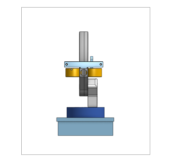
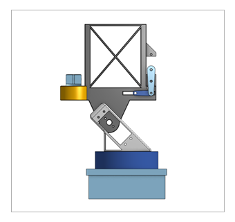
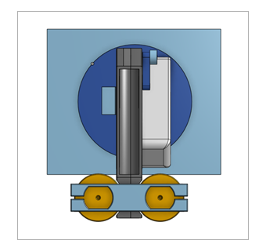
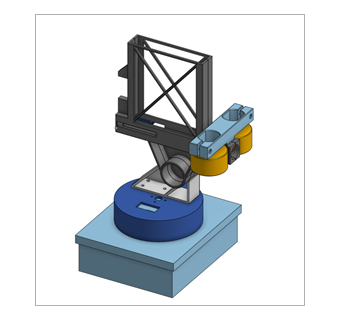
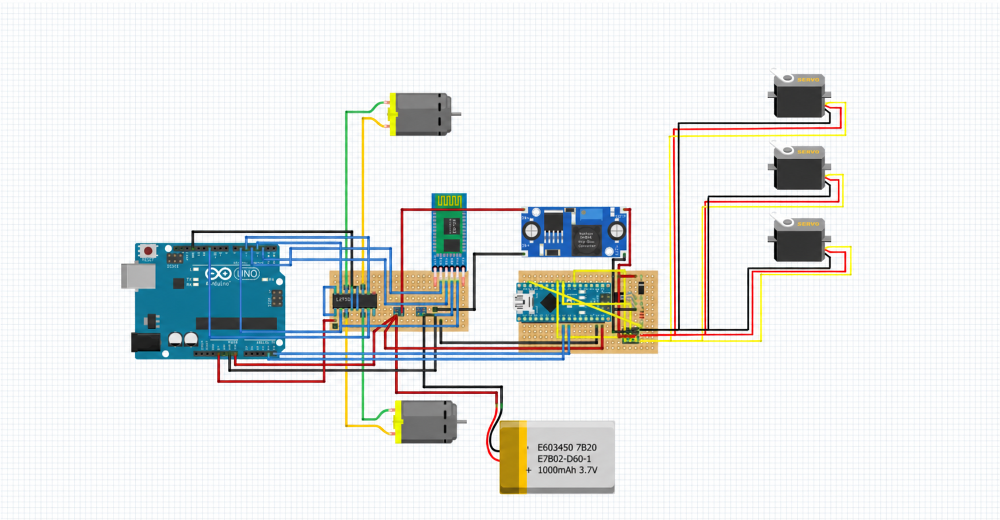

# Nerf Defense Turret

Nerf Defense Turret is a stationary project that uses Nerf foam bullets, a pan-and-tilt mechanism, a flywheel system, and a camera-based vision plan. The project is being built in stages so each movement can be tested before the camera system is added.

## CAD model

| **Front view** | **Side view** |
|---|---|
|  |  |
| **Top view** | **Isometric view** |
|  |  |

These views show the base, rotating platform, support structure, flywheel area, and magazine frame.

## Motor configuration

| Motor | Quantity | Job |
|---|---:|---|
| 130 DC motor | 2 | Spin the flywheel pair |
| MG996R servo | 1 | Pan the turret left and right |
| MG996R servo | 1 | Tilt the turret up and down |
| SG90 9 g servo | 1 | Move the pusher mechanism |

## Electronics overview

This diagram shows the overall electronics concept and components involved. It is a reference image, not a final pin-by-pin wiring diagram.

## Current control stage

The first version of the code focuses on basic left/right and up/down movement, starting the flywheels, and testing the pusher. This lets us test each motor and verify the mechanical design before adding computer vision.

## Planned camera vision stage

The next stage will add a camera mounted on top of the turret. OpenCV will be used to find a dark target against a light-colored room background and draw a bounding box around it. The software will use the target’s location in the camera frame to guide pan and tilt adjustments until it is centered. Distance information will also be used to refine the upward angle.

The current code does not yet include the vision module or autonomous actuation.

## Future direction

After the stationary-target version is working reliably, a future goal is to explore tracking a moving target and estimating its path.

## Project resources

- [CAD model](https://umd.onshape.com/documents/39f0e04ffb64eaaf0c0195c2/w/fc1426d76dea3f889e09ae53/e/ababacd6a38a37249e9c30a2?aa=true)
- Bill of materials
